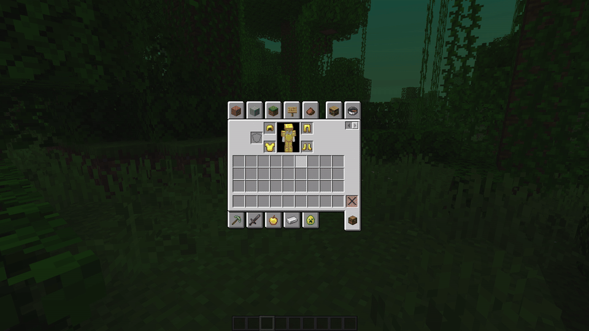

#  Flashback Inventory View

A client-side Fabric add-on that records your inventory and hotbar so you can see them in Flashback replays.

### Showcase

Requires Minecraft 1.21.11, Java 21, Fabric Loader 0.18.2 or newer, Fabric API, and Flashback 0.39.9.
